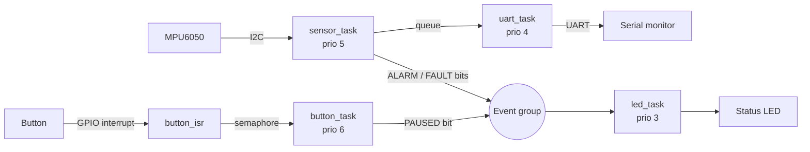

# Robot Sensor Monitor — ESP32 + FreeRTOS

A small monitoring unit for a mobile robot, written in C with **ESP-IDF** and **FreeRTOS**, and simulated on **[Wokwi](https://wokwi.com)** (no physical hardware needed).

The ESP32 reads an MPU6050 IMU over I2C, detects when the robot tilts too far, detects sensor failures, prints readings over UART, and shows system status on an LED. A push button (handled by an interrupt) pauses and resumes monitoring.

> **Note:** This project runs in simulation. The code uses standard ESP-IDF drivers and should run unchanged on a real ESP32 DevKit with the same wiring.

---

## Features

- **4 FreeRTOS tasks** with different priorities
- **I2C** driver for the MPU6050 (acceleration + temperature)
- **Tilt detection** — alarm when the robot tilts more than 30°
- **Fault detection** — sensor marked faulty after 3 failed I2C reads, with automatic recovery
- **UART** output of every reading
- **GPIO interrupt** on a button, passed to a task with a binary semaphore
- **Status LED** driven by shared system state

## Concepts used

| Concept | Where |
|---|---|
| Tasks and priorities | `sensor_task`, `uart_task`, `led_task`, `button_task` |
| Queue | Readings passed from `sensor_task` to `uart_task` |
| Binary semaphore | Button ISR wakes `button_task` |
| Event group | Shared status bits: `PAUSED`, `ALARM`, `FAULT` |
| Periodic timing | `xTaskDelayUntil()` gives a fixed 500 ms sample period |
| Interrupt (ISR) | Falling-edge interrupt on the button pin |
| I2C | MPU6050 register reads using the `i2c_master` driver |
| UART | `uart_write_bytes()` on UART0 |
| Error handling | I2C failure counting, fault flag, sensor re-initialisation |

## Architecture



## Wiring

| Part | Pin | ESP32 |
|---|---|---|
| MPU6050 | VCC | 3V3 |
| MPU6050 | GND | GND |
| MPU6050 | SDA | GPIO 21 |
| MPU6050 | SCL | GPIO 22 |
| LED (via 220 Ω resistor) | Anode | GPIO 2 |
| LED | Cathode | GND |
| Push button | one side | GPIO 4 (internal pull-up) |
| Push button | other side | GND |

The full circuit is in [`diagram.json`](diagram.json).

## LED status

| LED | Meaning |
|---|---|
| Slow blink (1 Hz) | Normal |
| Fast blink (5 Hz) | Tilt alarm |
| Solid ON | Sensor fault |
| OFF | Paused |

## How to run

**Requirements:** ESP-IDF v5.3 or newer (uses the new `i2c_master` driver).

### Option A — GitHub Codespaces (fully in the browser)
1. Open this repo → **Code → Codespaces → Create codespace**. The included `.devcontainer` sets up ESP-IDF and the Wokwi extension.
2. In the terminal:
   ```bash
   idf.py set-target esp32
   idf.py build
   ```
3. Press `F1` → **Wokwi: Start Simulator**. (Wokwi asks for a free license the first time.)

### Option B — Local VS Code
Install ESP-IDF and the Wokwi VS Code extension, then follow steps 2–3 above.

## How to test

- **Normal readings:** start the simulation and watch the serial monitor.
- **Tilt alarm:** click the MPU6050 in Wokwi and move the acceleration sliders (e.g. set Z low and X high). The LED blinks fast and the output shows `TILT ALARM`.
- **Pause/resume:** press the button. The LED turns off and readings stop; press again to resume.
- **Sensor fault:** remove the SDA wire in `diagram.json` and restart. The log shows `SENSOR FAULT` and the LED stays on.

## Sample output

```
=== Robot Sensor Monitor (ESP32 + FreeRTOS) ===
#1    ax= 0.00 ay= 0.00 az= 1.00 g | tilt=  0.0 deg | temp= 24.0 C | OK
#2    ax= 0.00 ay= 0.00 az= 1.00 g | tilt=  0.0 deg | temp= 24.0 C | OK
#3    ax= 0.71 ay= 0.00 az= 0.71 g | tilt= 45.0 deg | temp= 24.0 C | TILT ALARM
```
*(Replace with your own output after running.)*

## Debugging notes

<!-- Write down real problems you hit and how you solved them. Interviewers love this section. Example format:
- **Problem:** ...
- **Cause:** ...
- **Fix:** ...
-->

## Possible extensions

- Send readings over Wi-Fi (HTTP or MQTT)
- Add a mutex if a second task needs the I2C bus
- Print task CPU usage with `vTaskGetRunTimeStats()`
- Add a hardware watchdog

## Tools

C · ESP-IDF · FreeRTOS · Wokwi · GitHub Actions
